# MASLD Pathway Logic

This diagram documents the behavior currently implemented in
`src/pathway.ts` and configured in `src/config.ts`. It is a development
reference, not a clinically validated guideline.

```mermaid
flowchart TD
    START([Start: suspected steatosis]) --> METABOLIC{At least 3 of 5 configured<br/>metabolic syndrome criteria or<br/>pre-existing qualifying conditions?}

    METABOLIC -- No --> NOT_INDICATED([Exit: MASLD pathway not indicated])
    METABOLIC -- Yes --> ALCOHOL{Alcohol consumption}

    ALCOHOL -- "Male &gt;= 30 drinks/week<br/>Female &gt;= 25 drinks/week" --> ALD([Exit: MASLD pathway no longer applies;<br/>verify ALD case by case])
    ALCOHOL -- "Male &gt; 15 and &lt; 30<br/>Female &gt; 10 and &lt; 25" --> METALD([Exit: MASLD pathway no longer applies;<br/>verify MetALD case by case])
    ALCOHOL -- "At or below sex-specific MASLD alcohol limit" --> ALTERNATE{Any configured alternate<br/>diagnosis or cause?}

    ALTERNATE -- Yes --> ALT_EXIT([Exit: MASLD pathway no longer applies;<br/>verify DILI, HBV, HCV, or genetic cause<br/>case by case])
    ALTERNATE -- No --> ENZYMES[Review aminotransferases:<br/>ALT or AST &gt;= 200 U/L flags<br/>consider alternate cause]

    ENZYMES --> DIABETES{Type 2 diabetes?}

    DIABETES -- No --> FIB4[Calculate FIB-4:<br/>age x AST / &#40;platelets x sqrt&#40;ALT&#41;&#41;]
    DIABETES -- Yes --> APP[Calculate APP:<br/>albumin x platelets / 1000]

    FIB4 --> FIB4_AGE{Age &gt;= 65 years?}
    FIB4_AGE -- No --> FIB4_LOW_UNDER65{FIB-4 &lt; 1.3?}
    FIB4_AGE -- Yes --> FIB4_LOW_65{FIB-4 &lt; 2.0?}
    FIB4_LOW_UNDER65 -- Yes --> FIB4_1Y_PRIMARY([Do not refer to hepatology;<br/>continue management in primary care;<br/>repeat FIB-4 in 1-2 years])
    FIB4_LOW_65 -- Yes --> FIB4_1Y_PRIMARY
    FIB4_LOW_UNDER65 -- No --> FIB4_ADVANCED{FIB-4 &gt; 2.67?}
    FIB4_LOW_65 -- No --> FIB4_ADVANCED
    FIB4_ADVANCED -- Yes --> FIB4_REFER([Refer to hepatology for further management<br/>and intensify cardio-metabolic risk reduction])
    FIB4_ADVANCED -- "No: intermediate range<br/>through 2.67 inclusive" --> ELASTOGRAPHY[Perform noninvasive fibrosis staging:<br/>FibroScan, MR elastography,<br/>or shear wave elastography]

    APP --> APP_LOW{APP &lt;= 5.52?}
    APP_LOW -- Yes --> ELASTOGRAPHY
    APP_LOW -- No --> APP_HIGH{APP &gt;= 9.27?}
    APP_HIGH -- Yes --> APP_1Y([Repeat APP in 1 year])
    APP_HIGH -- No --> ELASTOGRAPHY

    ELASTOGRAPHY --> KPA{kPa &gt;= 8?}
    KPA -- Yes --> KPA_10{kPa &gt; 10?}
    KPA_10 -- No --> REFERRAL([Refer to hepatology and intensify<br/>cardiometabolic risk-factor modification])
    KPA_10 -- Yes --> REFERRAL_REPEAT([Refer to hepatology, intensify<br/>cardiometabolic risk-factor modification,<br/>and consider repeat elastography in 1-2 years])
    KPA -- No --> FIB4_1Y([Repeat FIB-4 in 1 year and intensify<br/>cardiometabolic risk-factor modification])
```

## Branch Criteria

Age is captured on the FIB-4 screen and used for FIB-4 calculation and
age-specific FIB-4 thresholds.

The five metabolic syndrome criteria are:

1. Waist circumference: male `>= 102 cm`; female `>= 88 cm`.
2. Triglycerides: `>= 1.7 mmol/L`; or current specific treatment for elevated
   triglycerides.
3. HDL cholesterol: male `< 1.0 mmol/L`; female `< 1.3 mmol/L`; or current
   specific treatment for low HDL cholesterol.
4. Blood pressure: systolic `>= 130 mmHg`, diastolic `>= 85 mmHg`, or current
   antihypertensive treatment.
5. Fasting glucose: `>= 5.6 mmol/L` or previous diagnosis of type 2 diabetes.

An alternate diagnosis or cause is any selected configured DILI medication,
positive HBsAg, positive HCV antibody with positive HCV RNA, or selected
configured genetic condition.

The configured DILI agents and classes are:

1. Amoxicillin-clavulanate (Augmentin).
2. Isoniazid.
3. Methotrexate.
4. Statins.
5. Immune checkpoint inhibitors.
6. Herbal and dietary supplements.

The configured genetic alternate causes are:

1. Alpha-1 antitrypsin deficiency.
2. Hereditary hemochromatosis.
3. Wilson's disease.
4. Glycogen storage disease.
5. Cystic fibrosis.

The aminotransferase threshold is a soft cutoff. ALT or AST `>= 200 U/L` flags
that an alternate cause should be considered, but it does not exclude the
patient from continuing through the MASLD/MASH pathway.

Alcohol thresholds use the configured `14 g` standard drink. The MASLD alcohol
limit is inclusive: female `<= 10 drinks/week` (`<= 20 g/day`) and male
`<= 15 drinks/week` (`<= 30 g/day`). Values above those limits exit this MASLD
pathway as configured MetALD range unless they meet the higher configured ALD
threshold.

FIB-4 uses age from the FIB-4 screen: `(age x AST) / (platelet count x
sqrt(ALT))`. For patients younger than `65`, FIB-4 `< 1.3` rules out advanced
fibrosis. For patients age `>= 65`, FIB-4 `< 2.0` rules out advanced fibrosis.
The low-risk recommendation is not to refer to hepatology, to continue
management in primary care, and to repeat FIB-4 in `1-2 years`. FIB-4 values from
the applicable low-risk cutoff through `2.67` inclusive are intermediate and
route to noninvasive fibrosis staging by FibroScan, MR elastography, or shear
wave elastography. FIB-4 `> 2.67` is treated as advanced fibrosis risk and
routes to hepatology referral with intensified cardio-metabolic risk reduction.

If elastography is below the configured referral threshold after intermediate
fibrosis staging, repeat FIB-4 in `1 year` and intensify cardiometabolic
risk-factor modification.

## Prototype Notes

- The APP middle range `> 5.52` and `< 9.27` is treated as a grey zone and
  routes to confirmatory secondary testing such as FibroScan/elastography.
