# MASLD Pathway Logic

This diagram documents the behavior currently implemented in
`src/pathway.ts` and configured in `src/config.ts`. It is a development
reference, not a clinically validated guideline.

```mermaid
flowchart TD
    START([Start: suspected steatosis]) --> KNOWN{Previously diagnosed<br/>metabolic syndrome?}
    KNOWN -- "Yes: capture sex for alcohol thresholds;<br/>skip criteria assessment" --> SCREEN
    KNOWN -- No --> METABOLIC{At least 3 of 5 configured<br/>metabolic syndrome criteria or<br/>pre-existing qualifying conditions?}
    METABOLIC -- No --> NOT_INDICATED([This pathway doesn't apply;<br/>metabolic syndrome criteria not met;<br/>FIB-4 not indicated by this pathway])
    METABOLIC -- Yes --> SCREEN[Exclude alternate diagnoses page:<br/>alcohol consumption, DILI medications,<br/>viral hepatitis, and genetic causes]
    SCREEN --> EXCLUSION{Alcohol above sex-specific limit<br/>or any alternate cause identified?}
    EXCLUSION -- Yes --> EXIT([This pathway doesn't apply because:<br/>list all applicable reasons;<br/>ALD: male &gt;= 30 or female &gt;= 25 drinks/week;<br/>MetALD: male &gt; 15 and &lt; 30 or female &gt; 10 and &lt; 25;<br/>and any identified DILI, HBV, HCV, or genetic cause])
    EXCLUSION -- No --> DIABETES{Type 2 diabetes?}
    DIABETES -- "No: enter age, ALT, AST, platelets once" --> FIB4
    DIABETES -- "Yes: ALT, AST, platelets, albumin required" --> ENZYMES
    ENZYMES[Review aminotransferases:<br/>ALT or AST &gt;= 200 U/L flags<br/>consider alternate cause]
    ENZYMES -- "Required values unavailable" --> MISSING([Assessment incomplete:<br/>list full branch bloodwork;<br/>order tests not already available;<br/>return to the same step with results])
    ENZYMES -- "Values available" --> APP[Calculate APP:<br/>albumin x platelets / 1000]
    FIB4[Calculate FIB-4:<br/>age x AST / &#40;platelets x sqrt&#40;ALT&#41;&#41;;<br/>ALT or AST &gt;= 200 U/L flags consider alternate cause]

    FIB4 -- "Required ALT, AST, platelets, or age unavailable" --> MISSING
    FIB4 -- "Values available" --> FIB4_AGE{Age &gt;= 65 years?}
    FIB4_AGE -- No --> FIB4_LOW_UNDER65{FIB-4 &lt; 1.3?}
    FIB4_AGE -- Yes --> FIB4_LOW_65{FIB-4 &lt; 2.0?}
    FIB4_LOW_UNDER65 -- Yes --> FIB4_1Y_PRIMARY([Do not refer to hepatology;<br/>continue management in primary care;<br/>repeat FIB-4 in 1-2 years])
    FIB4_LOW_65 -- Yes --> FIB4_1Y_PRIMARY
    FIB4_LOW_UNDER65 -- No --> FIB4_ADVANCED{FIB-4 &gt; 2.67?}
    FIB4_LOW_65 -- No --> FIB4_ADVANCED
    FIB4_ADVANCED -- Yes --> FIB4_REFER([Refer to hepatology for further management<br/>and intensify cardio-metabolic risk reduction])
    FIB4_ADVANCED -- "No: intermediate range<br/>through 2.67 inclusive" --> ELASTOGRAPHY[Perform noninvasive fibrosis staging:<br/>FibroScan, MR elastography,<br/>or shear wave elastography]

    APP -- "Required albumin or platelets unavailable" --> MISSING
    APP -- "Values available" --> APP_LOW{APP &lt;= 5.52?}
    APP_LOW -- Yes --> ELASTOGRAPHY
    APP_LOW -- No --> APP_HIGH{APP &gt;= 9.27?}
    APP_HIGH -- Yes --> APP_1Y([Repeat APP in 1 year])
    APP_HIGH -- No --> ELASTOGRAPHY

    ELASTOGRAPHY --> ELASTOGRAPHY_DONE{Elastography result available?}
    ELASTOGRAPHY_DONE -- "No: I don't have the required values button" --> ELASTOGRAPHY_OPTIONS([Refer for elastography:<br/>FibroScan: refer to hepatology or local expert;<br/>Shear wave: refer to radiology at QEII HSC, Central Zone;<br/>MR elastography: order MRI liver with elastography at QEII HSC, Central Zone])
    ELASTOGRAPHY_DONE -- Yes --> KPA{kPa &gt;= 8?}
    KPA -- Yes --> KPA_10{kPa &gt; 10?}
    KPA_10 -- No --> REFERRAL([Refer to hepatology and intensify<br/>cardiometabolic risk-factor modification])
    KPA_10 -- Yes --> REFERRAL_REPEAT([Refer to hepatology, intensify<br/>cardiometabolic risk-factor modification,<br/>and consider repeat elastography in 1-2 years])
    KPA -- No --> FIB4_1Y([Repeat FIB-4 in 1 year and intensify<br/>cardiometabolic risk-factor modification])
```

Every exclusion recommendation begins with "This pathway doesn't apply because"
and displays the reason in the Recommendation section and
copied EMR summary: unmet metabolic syndrome criteria, configured ALD or MetALD
alcohol range, or the identified alternate diagnosis or cause. Exclusion
recommendations contain this explanation. When metabolic syndrome criteria are
not met, the recommendation also states "FIB-4 not indicated by this pathway."

## Missing bloodwork

The aminotransferase, FIB-4, and APP pages offer “I don't have the required
values”. This bypasses form validation and ends the current assessment as
incomplete, without calculating a score or treating missing values as a pathway
exclusion. Diabetes is asked before laboratory inputs, so the recommendation lists
all bloodwork needed for the selected branch, including subsequent steps:
ALT, AST, and platelet count for the non-diabetes/FIB-4 branch; ALT, AST,
platelet count, and albumin for the diabetes/APP branch. The physician is asked
to order tests that are not already available, without repeating existing tests. Missing age prompts confirmation of age,
not a bloodwork order. A zero ALT or platelet count cannot be used as a FIB-4
denominator. The result and copied summary ask the physician to return with the
required values. The return instruction is a clickable link that restores the
same step and previously entered answers, including earlier screening choices.
The copied EMR summary includes this link. Values are encoded in the URL
fragment using a compact, versioned format (`#r2=...`; older `#resume=...` links remain supported), with no server storage. Opening the link replays
completed steps from their inputs to recalculate scores and routing; older
non-diabetes links that included an aminotransferase page carry those values
forward to FIB-4 without revisiting that page; malformed
or incompatible links open a fresh pathway. Back also returns to the same page
with available values preserved.
The option also works when current-page values are present but bloodwork for
the subsequent step is unavailable.

## Branch Criteria

Age is captured on the FIB-4 screen and used for FIB-4 calculation and
age-specific FIB-4 thresholds.

When metabolic syndrome is already diagnosed, the clinician can skip the five
criteria and proceed directly to the combined alternate diagnosis and alcohol screening page. Sex is still required for
alcohol thresholds. The report records the prior diagnosis without a calculated
criteria count or unentered measurements. This does not imply type 2 diabetes;
the later diabetes question remains separate.

The five metabolic syndrome criteria are:

1. Waist circumference: male `>= 102 cm`; female `>= 88 cm`.
2. Triglycerides: `>= 1.7 mmol/L`; or current specific treatment for elevated
   triglycerides.
3. HDL cholesterol: male `< 1.0 mmol/L`; female `< 1.3 mmol/L`; or current
   specific treatment for low HDL cholesterol.
4. Blood pressure: systolic `>= 130 mmHg`, diastolic `>= 85 mmHg`, or current
   antihypertensive treatment.
5. Fasting glucose: `>= 5.6 mmol/L` or previous diagnosis of type 2 diabetes.

Alcohol consumption is entered on the alternate diagnoses page. One submission
checks alcohol thresholds and all selected causes, preserving all reported
answers and listing all applicable exclusion reasons. Passing this combined
screen proceeds to the diabetes question. No type 2 diabetes routes directly
to FIB-4, where age, ALT, AST, and platelet count are entered once. Type 2
diabetes routes through aminotransferase review and then APP.

An alternate diagnosis or cause is any selected configured DILI medication,
positive HBsAg, positive HCV antibody with positive HCV RNA, or selected
configured genetic condition.

The configured DILI agents and classes are:

1. Amoxicillin-clavulanate (Augmentin).
2. Isoniazid.
3. Methotrexate.
4. Statins.
5. Immune checkpoint inhibitors.
6. Herbal and dietary supplements.

The configured genetic alternate causes are:

1. Alpha-1 antitrypsin deficiency.
2. Hereditary hemochromatosis.
3. Wilson's disease.
4. Glycogen storage disease.
5. Cystic fibrosis.

The aminotransferase threshold is a soft cutoff. ALT or AST `>= 200 U/L` flags
that an alternate cause should be considered, but it does not exclude the
patient from continuing through the MASLD/MASH pathway. The same flag is
calculated from the FIB-4 inputs on the direct non-diabetes route and appears
in the result and copied summary.

Alcohol thresholds use the configured `14 g` standard drink. The MASLD alcohol
limit is inclusive: female `<= 10 drinks/week` (`<= 20 g/day`) and male
`<= 15 drinks/week` (`<= 30 g/day`). Values above those limits exit this MASLD
pathway as configured MetALD range unless they meet the higher configured ALD
threshold.

FIB-4 uses age from the FIB-4 screen: `(age x AST) / (platelet count x
sqrt(ALT))`. For patients younger than `65`, FIB-4 `< 1.3` rules out advanced
fibrosis. For patients age `>= 65`, FIB-4 `< 2.0` rules out advanced fibrosis.
The low-risk recommendation is not to refer to hepatology, to continue
management in primary care, and to repeat FIB-4 in `1-2 years`. FIB-4 values from
the applicable low-risk cutoff through `2.67` inclusive are intermediate and
route to noninvasive fibrosis staging by FibroScan, MR elastography, or shear
wave elastography. FIB-4 `> 2.67` is treated as advanced fibrosis risk and
routes to hepatology referral with intensified cardio-metabolic risk reduction.

If elastography is below the configured referral threshold after intermediate
fibrosis staging, repeat FIB-4 in `1 year` and intensify cardiometabolic
risk-factor modification.

The elastography page displays a required liver stiffness input and an
“I don't have the required values” button. The button bypasses input validation
and shows testing referral options without requiring a dropdown selection.

If elastography has not been done when the pathway reaches noninvasive fibrosis
staging, the recommendation is to refer for elastography and list all three
testing options. FibroScan recommends referral to hepatology or a local expert
to have a FibroScan. Shear wave elastography recommends referral to radiology at
QEII HSC, Central Zone. MR elastography recommends ordering an MRI liver with
elastography at QEII HSC, Central Zone.

## Prototype Notes

- The APP middle range `> 5.52` and `< 9.27` is treated as a grey zone and
  routes to confirmatory secondary testing such as FibroScan/elastography.
